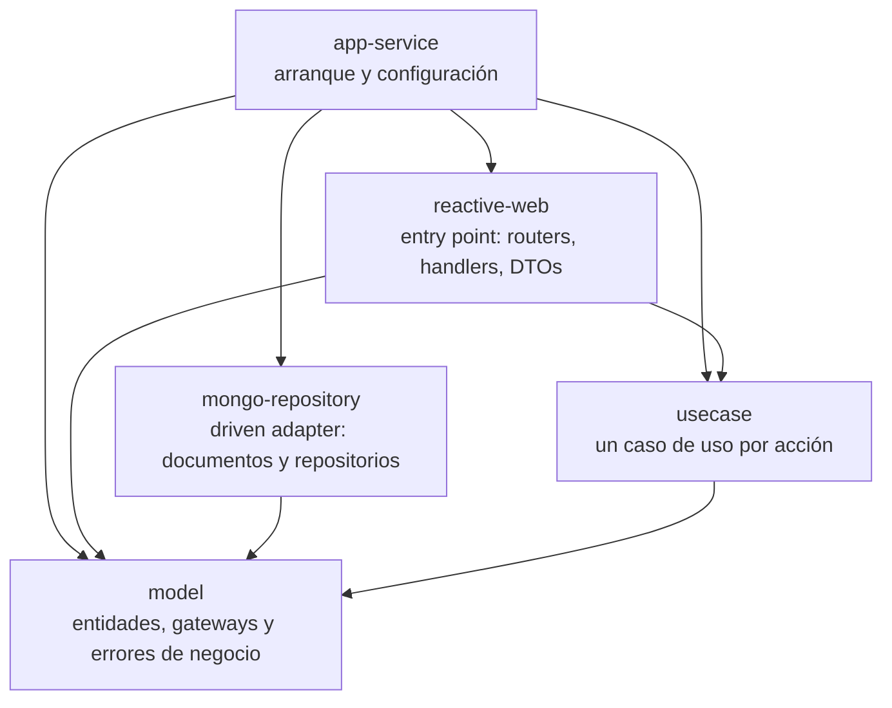

# Franchise API

API REST reactiva para gestionar franquicias, sus sucursales y el stock de los productos de cada sucursal. Permite crear y renombrar franquicias, sucursales y productos, actualizar el stock, eliminar productos y consultar, para una franquicia, el producto con más stock de cada sucursal.

- API desplegada: http://3.219.22.151:8080
- Swagger UI: http://3.219.22.151:8080/swagger-ui/index.html
- Especificación OpenAPI: http://3.219.22.151:8080/v3/api-docs

La URL corresponde al despliegue actual en AWS, creado con Terraform. Si la infraestructura se elimina con `terraform destroy`, la dirección deja de responder y un nuevo despliegue tendrá otra IP.

## Requisitos de la prueba

| Requisito | Tipo | Implementación |
|---|---|---|
| Proyecto desarrollado con Spring Boot | Criterio | Spring Boot 4.1.2 con WebFlux sobre Java 21, organizado con Clean Architecture |
| Agregar una franquicia | Criterio | `POST /api/franchises` |
| Agregar una sucursal a una franquicia | Criterio | `POST /api/franchises/{franchiseId}/branches` |
| Agregar un producto a una sucursal | Criterio | `POST /api/branches/{branchId}/products` |
| Eliminar un producto de una sucursal | Criterio | `DELETE /api/branches/{branchId}/products/{productId}` |
| Modificar el stock de un producto | Criterio | `PATCH /api/products/{productId}/stock` |
| Producto con más stock por sucursal de una franquicia, indicando la sucursal | Criterio | `GET /api/franchises/{franchiseId}/top-stock-products`, que devuelve la sucursal y su producto con más stock |
| Persistencia de datos en un proveedor de nube | Criterio | MongoDB Atlas M0 sobre AWS us-east-1; MongoDB 8.0 en local |
| Empaquetar la aplicación con Docker | Extra | `deployment/Dockerfile` multi-stage y `docker-compose.yml` con MongoDB |
| Programación reactiva | Extra | Spring WebFlux, Project Reactor y Spring Data Reactive MongoDB |
| Actualizar el nombre de una franquicia | Extra | `PATCH /api/franchises/{franchiseId}/name` |
| Actualizar el nombre de una sucursal | Extra | `PATCH /api/branches/{branchId}/name` |
| Actualizar el nombre de un producto | Extra | `PATCH /api/products/{productId}/name` |
| Aprovisionar la persistencia como infraestructura como código | Extra | Terraform crea el proyecto, el cluster M0, el usuario y la access list de MongoDB Atlas |
| Desplegar la solución completa en la nube | Extra | Terraform crea ECR, SSM Parameter Store, IAM y una EC2 en AWS; la API corre en la URL indicada arriba |

## Contenido

- [Requisitos de la prueba](#requisitos-de-la-prueba)
- [Arquitectura](#arquitectura)
- [Tecnologías](#tecnologías)
- [Estructura del proyecto](#estructura-del-proyecto)
- [Requisitos](#requisitos)
- [Ejecución local](#ejecución-local)
- [Pruebas](#pruebas)
- [Endpoints](#endpoints)
- [Errores](#errores)
- [Decisiones de diseño y casos borde](#decisiones-de-diseño-y-casos-borde)
- [Despliegue con Terraform](#despliegue-con-terraform)
- [Seguridad](#seguridad)
- [Limitaciones conocidas](#limitaciones-conocidas)
- [Flujo de Git](#flujo-de-git)

## Arquitectura

El proyecto sigue Clean Architecture con el plugin Scaffold Clean Architecture de Bancolombia, en su variante reactiva. Cada capa es un módulo de Gradle:



La regla de dependencias apunta siempre hacia el dominio:

- `model` no depende de ningún otro módulo ni de Spring. Contiene las entidades `Franchise`, `Branch` y `Product`, los gateways (interfaces de repositorio), la proyección `TopStockProduct` y el catálogo de errores `BusinessError`.
- `usecase` depende solo de `model`. Cada acción es una clase con un único método público `execute`.
- `mongo-repository` implementa los gateways de `model`. Sus documentos y mapeos son propios y no se exponen fuera del módulo.
- `reactive-web` traduce HTTP a casos de uso. Los DTOs de petición y respuesta están separados del dominio y los handlers no contienen lógica de negocio.
- `app-service` es el único módulo que conoce a todos. Arranca la aplicación y registra los casos de uso como beans sin que el dominio tenga anotaciones de Spring.

El build valida estas reglas con la tarea `validateStructure` del plugin y con las pruebas de arquitectura (ArchUnit) que el plugin genera en `app-service`.

## Tecnologías

| Área | Tecnología |
|---|---|
| Lenguaje y build | Java 21, Gradle 9.9.1 (wrapper incluido), Lombok |
| Framework | Spring Boot 4.1.2, Spring WebFlux con router functions, Project Reactor |
| Persistencia | MongoDB 8.0 con Spring Data Reactive MongoDB; MongoDB Atlas M0 en el despliegue |
| Documentación | springdoc-openapi 3.2.0 con Swagger UI |
| Pruebas | JUnit 5, Mockito, StepVerifier, WebTestClient, Testcontainers, JaCoCo, Pitest, ArchUnit |
| Arquitectura | Scaffold Clean Architecture de Bancolombia 5.2.1 |
| Contenedores | Docker multi-stage, Docker Compose |
| Infraestructura | Terraform con los providers aws 6.73.0, mongodbatlas 2.21.0 y random 3.9.1 |
| Nube | AWS us-east-1: ECR, EC2 t4g.micro (arm64), SSM Parameter Store, IAM |

## Estructura del proyecto

```
.
├── applications/app-service          arranque, configuración y application.yaml
├── domain
│   ├── model                         entidades, gateways, TopStockProduct y errores de negocio
│   └── usecase                       los nueve casos de uso
├── infrastructure
│   ├── driven-adapters
│   │   └── mongo-repository          documentos, repositorios de Spring Data y adaptadores
│   └── entry-points
│       └── reactive-web              routers, handlers, DTOs, manejo de errores y configuración web
├── deployment
│   ├── Dockerfile                    imagen multi-stage de la aplicación
│   └── terraform                     infraestructura de AWS y MongoDB Atlas
├── docker-compose.yml                MongoDB y la API para ejecución local
├── build.gradle                      configuración común y regla de cobertura
└── settings.gradle                   plugin del scaffold, que descubre los módulos
```

## Requisitos

- Para ejecutar con Docker: Docker con Docker Compose.
- Para ejecutar sin Docker: JDK 21 y una instancia de MongoDB accesible. El proyecto incluye el wrapper de Gradle, no hace falta instalar Gradle.
- Para desplegar: Terraform 1.9 o superior, AWS CLI v2 y una cuenta de MongoDB Atlas.

## Ejecución local

### Con Docker

Desde la raíz del repositorio:

```bash
docker compose up --build
```

Compose levanta dos servicios:

- `mongo`: MongoDB 8.0 con un volumen persistente, un healthcheck y el puerto 27017 publicado.
- `app`: la API, construida con `deployment/Dockerfile`. Arranca solo cuando MongoDB está sano y queda disponible en http://localhost:8080.

Para comprobar que está arriba:

```bash
curl http://localhost:8080/actuator/health
```

Respuesta esperada: `{"groups":["liveness","readiness"],"status":"UP"}`. Swagger UI queda en http://localhost:8080/swagger-ui/index.html.

Para detener todo y borrar los datos:

```bash
docker compose down -v
```

### Sin Docker

La aplicación lee la conexión de la variable `MONGODB_URI`. Si no está definida usa `mongodb://localhost:27017/franchises`. Puede usarse cualquier MongoDB local; la forma más simple es levantar solo el servicio de base de datos de Compose:

```bash
docker compose up -d mongo
./gradlew :app-service:bootRun
```

Para apuntar a otra base de datos:

```bash
MONGODB_URI=mongodb://otro-host:27017/franchises ./gradlew :app-service:bootRun
```

Los índices únicos se crean al arrancar la aplicación, así que MongoDB debe estar disponible antes de iniciarla.

## Pruebas

```bash
./gradlew build
```

El build compila, ejecuta todas las pruebas, genera los reportes de cobertura y de mutación, y falla si la cobertura de líneas de algún módulo baja del 80 %. Actualmente hay 196 pruebas.

| Módulo | Pruebas | Qué cubren |
|---|---|---|
| model | 45 | Reglas de cada entidad: nombres recortados y obligatorios, stock no negativo y obligatorio, inmutabilidad |
| usecase | 36 | Cada caso de uso con Mockito y StepVerifier: camino feliz, recursos no encontrados, validaciones, conflictos y que no se guarde nada cuando hay error |
| mongo-repository | 34 | Mapeo de documentos, delegación y traducción de duplicados (unitarias) y 7 pruebas de integración contra MongoDB real |
| reactive-web | 74 | Cada endpoint con WebTestClient y casos de uso simulados, el manejador de errores y las cabeceras de seguridad |
| app-service | 7 | Registro de casos de uso y reglas de arquitectura |

### Pruebas de integración

`MongoAdaptersIntegrationTest` levanta un contenedor `mongo:8.0` con Testcontainers y comprueba contra una base real los índices únicos, el orden de las sucursales por nombre y el desempate por nombre del producto con más stock. Requiere Docker. Si Docker no está disponible, esas 7 pruebas se marcan como omitidas y el build sigue en verde.

Para ejecutarlas por separado:

```bash
./gradlew :mongo-repository:test --tests '*MongoAdaptersIntegrationTest'
```

### Cobertura

JaCoCo genera un reporte por módulo en `<módulo>/build/reports/jacocoHtml/index.html`. La regla de cobertura mínima (80 % de líneas por módulo) excluye la clase principal y los paquetes `config`. Para generar los reportes y validar la regla sin el resto del build:

```bash
./gradlew jacocoTestReport jacocoTestCoverageVerification
```

La cobertura actual es del 100 % de líneas en `model`, `usecase` y `mongo-repository`, y del 99 % en `reactive-web`.

### Pruebas de mutación

Pitest se ejecuta dentro de `./gradlew build` y deja su reporte en `<módulo>/build/reports/pitest/index.html`. Para ejecutarlo solo en los módulos con código:

```bash
./gradlew :model:pitest :usecase:pitest :mongo-repository:pitest :reactive-web:pitest
```

## Endpoints

| Método | Ruta | Descripción | Éxito |
|---|---|---|---|
| POST | `/api/franchises` | Crea una franquicia | 201 |
| PATCH | `/api/franchises/{franchiseId}/name` | Renombra una franquicia | 200 |
| POST | `/api/franchises/{franchiseId}/branches` | Agrega una sucursal a una franquicia | 201 |
| PATCH | `/api/branches/{branchId}/name` | Renombra una sucursal | 200 |
| POST | `/api/branches/{branchId}/products` | Agrega un producto a una sucursal | 201 |
| DELETE | `/api/branches/{branchId}/products/{productId}` | Elimina un producto de una sucursal | 204 |
| PATCH | `/api/products/{productId}/stock` | Actualiza el stock de un producto | 200 |
| PATCH | `/api/products/{productId}/name` | Renombra un producto | 200 |
| GET | `/api/franchises/{franchiseId}/top-stock-products` | Producto con más stock de cada sucursal de la franquicia | 200 |

Los PATCH responden con el recurso actualizado y el DELETE responde sin cuerpo.

### Ejemplos

Los ejemplos usan variables de shell para encadenar los identificadores. Con la API local:

```bash
API=http://localhost:8080
```

Crear una franquicia:

```bash
curl -s -X POST "$API/api/franchises" \
  -H 'Content-Type: application/json' \
  -d '{"name": "Pizza Place"}'
```

```json
{"id":"6af7a0b1c2d3e4f5a6b7c8d9","name":"Pizza Place"}
```

Renombrar la franquicia:

```bash
FRANCHISE_ID=6af7a0b1c2d3e4f5a6b7c8d9

curl -s -X PATCH "$API/api/franchises/$FRANCHISE_ID/name" \
  -H 'Content-Type: application/json' \
  -d '{"name": "Pizza Palace"}'
```

```json
{"id":"6af7a0b1c2d3e4f5a6b7c8d9","name":"Pizza Palace"}
```

Agregar una sucursal:

```bash
curl -s -X POST "$API/api/franchises/$FRANCHISE_ID/branches" \
  -H 'Content-Type: application/json' \
  -d '{"name": "Airport"}'
```

```json
{"id":"6af7a0b1c2d3e4f5a6b7c8da","franchiseId":"6af7a0b1c2d3e4f5a6b7c8d9","name":"Airport"}
```

Renombrar la sucursal:

```bash
BRANCH_ID=6af7a0b1c2d3e4f5a6b7c8da

curl -s -X PATCH "$API/api/branches/$BRANCH_ID/name" \
  -H 'Content-Type: application/json' \
  -d '{"name": "Airport Terminal 1"}'
```

```json
{"id":"6af7a0b1c2d3e4f5a6b7c8da","franchiseId":"6af7a0b1c2d3e4f5a6b7c8d9","name":"Airport Terminal 1"}
```

Agregar un producto:

```bash
curl -s -X POST "$API/api/branches/$BRANCH_ID/products" \
  -H 'Content-Type: application/json' \
  -d '{"name": "Pepperoni", "stock": 15}'
```

```json
{"id":"6af7a0b1c2d3e4f5a6b7c8db","branchId":"6af7a0b1c2d3e4f5a6b7c8da","name":"Pepperoni","stock":15}
```

Actualizar el stock:

```bash
PRODUCT_ID=6af7a0b1c2d3e4f5a6b7c8db

curl -s -X PATCH "$API/api/products/$PRODUCT_ID/stock" \
  -H 'Content-Type: application/json' \
  -d '{"stock": 35}'
```

```json
{"id":"6af7a0b1c2d3e4f5a6b7c8db","branchId":"6af7a0b1c2d3e4f5a6b7c8da","name":"Pepperoni","stock":35}
```

Renombrar el producto:

```bash
curl -s -X PATCH "$API/api/products/$PRODUCT_ID/name" \
  -H 'Content-Type: application/json' \
  -d '{"name": "Pepperoni Large"}'
```

```json
{"id":"6af7a0b1c2d3e4f5a6b7c8db","branchId":"6af7a0b1c2d3e4f5a6b7c8da","name":"Pepperoni Large","stock":35}
```

Consultar el producto con más stock de cada sucursal:

```bash
curl -s "$API/api/franchises/$FRANCHISE_ID/top-stock-products"
```

```json
[{"branchId":"6af7a0b1c2d3e4f5a6b7c8da","branchName":"Airport Terminal 1","productId":"6af7a0b1c2d3e4f5a6b7c8db","productName":"Pepperoni Large","stock":35}]
```

Eliminar el producto (responde 204 sin cuerpo):

```bash
curl -s -o /dev/null -w '%{http_code}\n' -X DELETE "$API/api/branches/$BRANCH_ID/products/$PRODUCT_ID"
```

```
204
```

Los identificadores de los ejemplos son ilustrativos; MongoDB genera uno distinto en cada creación.

## Errores

Todos los errores responden con el mismo cuerpo:

```json
{"code":"FRANCHISE_NOT_FOUND","message":"Franchise not found"}
```

| HTTP | code | Cuándo |
|---|---|---|
| 400 | `INVALID_NAME` | Nombre ausente, nulo, vacío o solo con espacios |
| 400 | `INVALID_STOCK` | Stock ausente, nulo o negativo |
| 400 | `INVALID_REQUEST` | Cuerpo vacío, JSON mal formado o stock que no es un entero JSON (`1.5`, `"10"`, `true`) |
| 404 | `FRANCHISE_NOT_FOUND` | La franquicia no existe |
| 404 | `BRANCH_NOT_FOUND` | La sucursal no existe |
| 404 | `PRODUCT_NOT_FOUND` | El producto no existe o no pertenece a la sucursal indicada |
| 409 | `FRANCHISE_NAME_ALREADY_EXISTS` | Ya existe una franquicia con ese nombre |
| 409 | `BRANCH_NAME_ALREADY_EXISTS` | Ya existe una sucursal con ese nombre en la franquicia |
| 409 | `PRODUCT_NAME_ALREADY_EXISTS` | Ya existe un producto con ese nombre en la sucursal |
| 404 | `NOT_FOUND` | Ruta inexistente o método no definido para la ruta |
| 415 | `UNSUPPORTED_MEDIA_TYPE` | `Content-Type` distinto de JSON en una petición con cuerpo |
| 500 | `INTERNAL_ERROR` | Error inesperado; se registra en el log y no se exponen detalles |

Algunos ejemplos:

```bash
curl -s -X POST "$API/api/franchises" -H 'Content-Type: application/json' -d '{"name": "   "}'
```

```json
{"code":"INVALID_NAME","message":"Name must not be empty"}
```

```bash
curl -s -X POST "$API/api/branches/$BRANCH_ID/products" -H 'Content-Type: application/json' -d '{"name": "Calzone"}'
```

```json
{"code":"INVALID_STOCK","message":"Stock is required and must be greater than or equal to zero"}
```

```bash
curl -s -X POST "$API/api/franchises" -H 'Content-Type: application/json' -d '{"name": '
```

```json
{"code":"INVALID_REQUEST","message":"Request body is missing or malformed"}
```

```bash
curl -s -X POST "$API/api/franchises" -H 'Content-Type: application/json' -d '{"name": "Pizza Palace"}'
```

```json
{"code":"FRANCHISE_NAME_ALREADY_EXISTS","message":"A franchise with this name already exists"}
```

```bash
curl -s "$API/api/franchises/000000000000000000000000/top-stock-products"
```

```json
{"code":"FRANCHISE_NOT_FOUND","message":"Franchise not found"}
```

## Decisiones de diseño y casos borde

### Modelo y reglas

- Las entidades son inmutables. Se crean con métodos de fábrica (`create`) y cada cambio (`rename`, `updateStock`) devuelve una instancia nueva después de validar sus reglas.
- Los nombres se recortan (`"  Pizza Place  "` se guarda como `"Pizza Place"`) y no pueden quedar vacíos.
- El stock es un entero mayor o igual a cero y es obligatorio, tanto al crear el producto como al actualizarlo.
- Las validaciones del dominio corren dentro del flujo reactivo, de modo que un dato inválido llega como error del `Mono` y nunca como una excepción fuera de él.

### Nombres únicos

- La unicidad la garantizan los índices únicos de MongoDB y no una consulta previa del tipo "existe": `franchises.name`, `branches (franchiseId, name)` y `products (branchId, name)`. Así no hay carrera entre dos peticiones simultáneas con el mismo nombre. El adaptador traduce la `DuplicateKeyException` al 409 que corresponde.
- El ámbito de la unicidad cambia según el recurso: el nombre de una franquicia es único en todo el sistema, el de una sucursal solo dentro de su franquicia y el de un producto solo dentro de su sucursal.
- La comparación distingue mayúsculas de minúsculas: `Pizza Place` y `pizza place` son nombres distintos.

### Producto con más stock

- Recorre las sucursales de la franquicia ordenadas por nombre y devuelve, para cada una, el producto con más stock.
- Las sucursales sin productos se omiten y una franquicia sin sucursales devuelve `[]`.
- Si dos productos empatan en stock, gana el de nombre menor en orden ascendente. La consulta lo resuelve en MongoDB ordenando por stock descendente y nombre ascendente.

### Validación de peticiones

- Un cuerpo vacío o un JSON mal formado responden 400 `INVALID_REQUEST` sin llegar al caso de uso.
- Un `name` o `stock` ausente o nulo llega al dominio y responde 400 `INVALID_NAME` o `INVALID_STOCK`, nunca 500.
- Jackson está configurado para no convertir tipos de forma implícita en los números: `1.5` no se trunca a `1` y `"10"` no se convierte en `10`. Ambos responden 400 `INVALID_REQUEST`. Un número enviado como nombre (`{"name": 123}`) sí se acepta como el texto `"123"`.
- Cuando el recurso no existe y además el nombre o el stock son inválidos, la respuesta es 404, porque el caso de uso comprueba primero la existencia. Un cuerpo vacío o mal formado, en cambio, responde 400 aunque el recurso no exista, porque se rechaza antes de llegar al caso de uso.
- Un identificador con formato que no es un ObjectId válido responde 404 del recurso correspondiente, no 400.
- Al eliminar un producto se valida primero la sucursal (`BRANCH_NOT_FOUND`) y luego que el producto pertenezca a ella (`PRODUCT_NOT_FOUND`). Un producto existente no se puede borrar a través de otra sucursal.

### Respuestas HTTP

- Los POST responden 201 con el recurso creado y sin cabecera `Location`, porque la API no expone un GET por identificador.
- Las rutas son funciones de router: un método no definido sobre una ruta existente responde 404 `NOT_FOUND`, no 405.
- El manejador global de errores convierte los tipos de error del dominio (`VALIDATION`, `NOT_FOUND`, `CONFLICT`) en códigos HTTP, de modo que el dominio no conoce HTTP.

## Despliegue con Terraform

El código está en `deployment/terraform`, separado por responsabilidad (`atlas`, `ecr`, `iam`, `ssm`, `compute`, `outputs`). Crea:

- En MongoDB Atlas: el proyecto `franchise-api`, un cluster M0 en AWS `US_EAST_1`, un usuario con `readWrite` solo sobre la base `franchises` y una access list que solo admite la Elastic IP de la instancia.
- En AWS:
  - un repositorio ECR con escaneo al subir y retención de las últimas 5 imágenes;
  - la URI de conexión como `SecureString` en SSM Parameter Store;
  - un rol de instancia con los permisos mínimos;
  - una instancia EC2 `t4g.micro` (arm64) con Amazon Linux 2023 en la VPC por defecto, con Elastic IP y un Security Group que solo abre el puerto 8080.

Al arrancar, la instancia instala Docker y registra el servicio systemd `franchise-api`. El servicio:

1. Hace login en ECR.
2. Lee la URI desde SSM.
3. Descarga la imagen `latest`.
4. La ejecuta en el puerto 8080.

Si falla, por ejemplo porque todavía no hay imagen, systemd lo reintenta cada 30 segundos.

### 1. Preparar credenciales

- AWS: un perfil de AWS CLI llamado `franchise` con permisos para crear los recursos anteriores. Es el valor por defecto de la variable `aws_profile`, que puede cambiarse.
- MongoDB Atlas: una service account de la organización. Este despliegue se hizo con el rol Organization Owner; Organization Project Creator es una alternativa de menor privilegio que no se ha verificado con este código. La API Access List de la service account debe incluir la IP pública desde la que se ejecuta Terraform, porque Atlas rechaza las llamadas de su API desde direcciones que no estén en esa lista. Las credenciales y el identificador de la organización se pasan solo por variables de entorno:

```bash
export MONGODB_ATLAS_CLIENT_ID=...
export MONGODB_ATLAS_CLIENT_SECRET=...
export TF_VAR_atlas_org_id=...
```

Ninguna credencial va en el código, en archivos `.tfvars` ni en el repositorio.

### 2. Crear la infraestructura

```bash
cd deployment/terraform
terraform init
terraform plan
terraform apply
```

`terraform apply` muestra el plan y pide confirmación. Al terminar imprime tres valores, que también se pueden consultar con `terraform output`:

```
api_url            = "http://<elastic-ip>:8080"
ecr_repository_url = "<cuenta>.dkr.ecr.us-east-1.amazonaws.com/franchise-api"
swagger_ui_url     = "http://<elastic-ip>:8080/swagger-ui/index.html"
```

### 3. Subir la imagen

La instancia es arm64, así que la imagen se construye para esa plataforma. Desde `deployment/terraform`:

```bash
REGISTRY=$(terraform output -raw ecr_repository_url)
cd ../..

aws ecr get-login-password --profile franchise --region us-east-1 \
  | docker login --username AWS --password-stdin "${REGISTRY%%/*}"

docker build --platform linux/arm64 -f deployment/Dockerfile -t "${REGISTRY}:latest" .
docker push "${REGISTRY}:latest"
```

En el primer despliegue no hace falta nada más: el servicio de la instancia toma la imagen en su siguiente reintento, normalmente en menos de un minuto.

### 4. Verificar

Desde `deployment/terraform`:

```bash
curl "$(terraform output -raw api_url)/actuator/health"
```

Respuesta esperada: `{"groups":["liveness","readiness"],"status":"UP"}`.

### Publicar una versión nueva

Después de subir una imagen nueva con el mismo tag, se reinicia el servicio a través de SSM. Así no hace falta acceso SSH, que no existe:

```bash
INSTANCE_ID=$(aws ec2 describe-instances --profile franchise --region us-east-1 \
  --filters Name=tag:Name,Values=franchise-api Name=instance-state-name,Values=running \
  --query 'Reservations[0].Instances[0].InstanceId' --output text)

aws ssm send-command --profile franchise --region us-east-1 \
  --instance-ids "$INSTANCE_ID" \
  --document-name AWS-RunShellScript \
  --parameters 'commands=["systemctl restart franchise-api"]'
```

### Eliminar todo

Desde `deployment/terraform`:

```bash
terraform destroy
```

Elimina todos los recursos de AWS y de Atlas, incluido el cluster con sus datos. El repositorio ECR se borra aunque tenga imágenes (`force_delete`).

## Seguridad

- **Secretos:** no hay secretos en el repositorio.
  - Las credenciales de Atlas llegan por variables de entorno.
  - La contraseña de la base de datos la genera Terraform: 32 caracteres alfanuméricos.
  - La URI completa se guarda cifrada en SSM Parameter Store con la clave administrada `aws/ssm`.
- **Estado de Terraform:** `terraform.tfstate` es local y está excluido de Git, pero contiene la contraseña y la URI. Hay que protegerlo como un secreto.
- **Rol de la instancia:** solo puede leer el parámetro de su URI y descargar imágenes de su propio repositorio ECR.
  - Tiene `AmazonSSMManagedInstanceCore` para administrarla con Session Manager.
  - Esa política concede lectura de parámetros sobre `*`, por eso el rol agrega un `Deny` explícito sobre cualquier otro parámetro.
  - No necesita `kms:Decrypt`: la clave `aws/ssm` ya lo permite a la cuenta cuando la llamada pasa por SSM.
- **Instancia:**
  - Sin llave SSH y sin puerto 22. El Security Group solo admite tráfico entrante en el 8080.
  - IMDSv2 obligatorio y disco raíz cifrado.
  - La URI se entrega al contenedor con un archivo en `/run` con permisos `600`, no como argumento visible en la lista de procesos.
- **Contenedor:**
  - Corre con un usuario sin privilegios (uid 10001) sobre una imagen JRE Alpine, con los paquetes del sistema actualizados al construirla.
  - ECR escanea cada imagen al subirla.
  - El contexto de build es una lista blanca, así que solo se envía el código necesario.
- **MongoDB Atlas:** el usuario de la aplicación solo tiene `readWrite` sobre `franchises` y la access list solo admite la Elastic IP de la instancia.
- **Cabeceras HTTP:** las respuestas incluyen `Content-Security-Policy`, `X-Content-Type-Options: nosniff`, `Cache-Control: no-store`, `Referrer-Policy` y `Strict-Transport-Security`, y no incluyen la cabecera `Server`. La política de contenido es estricta en toda la API y solo se relaja para Swagger UI y `/v3/api-docs`, que necesitan estilos en línea e imágenes `data:`.
- **Errores:** los errores inesperados responden con un mensaje genérico. El detalle queda solo en el log.

## Limitaciones conocidas

- **Sin HTTPS:** el despliegue expone HTTP en el puerto 8080, sin TLS ni dominio propio. Por eso los navegadores ignoran la cabecera `Strict-Transport-Security`.
- **Sin autenticación:** la API no tiene autenticación ni autorización, y Swagger UI queda publicado en el despliegue.
- **Una sola instancia:** no hay alta disponibilidad ni autoescalado, y la `t4g.micro` tiene 1 GiB de memoria. El contenedor está limitado a 768 MiB.
- **Límites del M0 de Atlas:** es un cluster compartido, con 512 MB de almacenamiento, sin backups y sin pausa.
- **Publicación manual, sin CI/CD:** no hay pipeline de integración ni de despliegue continuo. Publicar una imagen nueva requiere subirla a ECR y reiniciar el servicio por SSM.
- **Estado de Terraform local:** sin backend remoto ni bloqueo, así que no está pensado para que varias personas apliquen cambios a la vez.
- **Índices al arrancar:** se crean al iniciar la aplicación. Si MongoDB no está disponible en ese momento, la aplicación arranca sin crearlos hasta el siguiente reinicio.
- **Solo los endpoints pedidos:** no hay listados, consultas por identificador ni borrado de franquicias o sucursales.

## Flujo de Git

- `main` contiene las versiones publicadas y `develop` la integración.
- Cada cambio se trabaja en una rama desde `develop` (`feature/<nombre>`, `fix/<nombre>` o `chore/<nombre>`) y entra a `develop` por pull request con merge commit.
- Los commits siguen Conventional Commits en inglés, en imperativo y minúscula, con los tipos `feat`, `fix`, `test`, `chore`, `docs`, `refactor` y `build`.
- Las versiones se publican con un pull request de `develop` a `main`, un tag anotado y un release en GitHub. La primera versión es `v1.0.0`.
